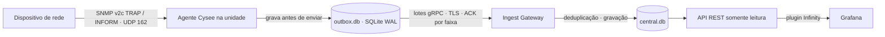

# Cysee

**Cysee** é um projeto open source de monitoramento de eventos de rede, desenvolvido pela Liga Acadêmica de Cibersegurança Cylock, da Universidade Federal de Sergipe (UFS).

O primeiro objetivo é validar, em laboratório, a coleta de traps SNMP, o armazenamento confiável na unidade monitorada e a entrega dos eventos a um painel central — sem perder nem duplicar eventos depois que foram gravados localmente.

> **Estado do projeto:** planejamento e definição do MVP. Este repositório contém os documentos de escopo e arquitetura; os componentes de software ainda estão em desenvolvimento.

## Objetivo do MVP

Demonstrar o fluxo ponta a ponta em um laboratório baseado em Docker:



A hipótese central do MVP é: **um evento confirmado como gravado na outbox local não se perde nem aparece duplicado no central**, mesmo após a queda do agente ou uma partição de rede.

## Escopo

### Incluído no MVP

- Recepção de **SNMP v2c TRAP e INFORM** na porta UDP 162.
- Agente em Rust, com armazenamento local persistente em SQLite no modo WAL.
- Numeração sequencial por unidade (`node_id`, `seq`).
- Envio at-least-once em lotes gRPC com ACK por faixa e deduplicação no central.
- Canal gRPC protegido por TLS, com certificados gerados manualmente para o laboratório.
- Núcleo central com Ingest Gateway e banco de eventos.
- API REST de consulta e dashboard Grafana usando o plugin Infinity.
- Contadores por unidade: recebidos, gravados, enviados e confirmados.
- Validação em laboratório com testes de queda do agente, partição de rede e carga.

### Fora do MVP

Os itens abaixo pertencem a etapas futuras e **não são requisitos da primeira entrega**:

- SNMP v1/v3 e polling SNMP (UDP 161).
- Coleta de Syslog e suporte a Windows.
- Cadeia de integridade BLAKE3, assinatura Ed25519 e marcadores GAP assinados.
- Deduplicação de rajadas, rate limit por origem e regras/correlação de eventos.
- CA interna, mTLS completo e enrollment por token físico Pico RP2350.
- Alta disponibilidade ou cluster do núcleo central.

O MVP mede perdas anteriores à gravação por meio dos contadores; não promete registrar criptograficamente cada perda ocorrida antes da persistência.

## Como funciona

1. Um dispositivo de rede envia um trap ou INFORM SNMP v2c ao agente da sua unidade.
2. O agente decodifica o pacote e normaliza o evento, preservando a OID numérica mesmo quando não houver resolução de nome.
3. O agente atribui um `seq` e grava o evento na outbox local. A gravação acontece antes de o evento ser considerado persistido.
4. O sender envia eventos pendentes em lotes. O lote é fechado pelo primeiro limite atingido: **500 eventos**, **256 KB antes da compressão** ou **500 ms** desde o primeiro evento pendente.
5. O Ingest Gateway grava o lote e deduplica pela chave `(node_id, seq)`. Só depois da gravação confirma a faixa ao agente.
6. O agente marca os eventos como confirmados apenas após receber o ACK explícito. Em caso de falha de rede, mantém a outbox e tenta novamente.
7. A API REST expõe os dados em modo somente leitura; o Grafana consulta a API, não o banco diretamente.

## Laboratório e validação

O plano inicial de usar EVE-NG foi substituído por um laboratório baseado em Docker para emular **duas unidades monitoradas, dispositivos de rede e um núcleo central**. A topologia deverá separar as unidades em redes Docker distintas e permitir testar o caminho de ingestão, a indisponibilidade do central e a retomada do envio. Os principais testes do MVP são:

| Teste | Resultado esperado |
|---|---|
| Ponta a ponta | Trap visível no painel em até 5 segundos. |
| Queda abrupta do agente (`kill -9`) | Nenhum evento já gravado na outbox é perdido após a retomada. |
| Partição unidade–central por 10 minutos | A unidade acumula eventos localmente; após a reconexão, a fila drena sem perda nem duplicação. |
| Carga crescente de traps | A taxa em que começa a ocorrer perda é medida e documentada. |
| Contabilidade | Diferenças entre eventos gerados, recebidos, gravados e confirmados são explicadas pelos contadores disponíveis. |

Os valores são metas iniciais para o laboratório e podem ser ajustados com base nas medições.

## Tecnologias previstas

- **Agente e núcleo:** Rust; Tokio para tarefas assíncronas.
- **Armazenamento na unidade:** SQLite em modo WAL.
- **Transporte:** gRPC/HTTP2 com TLS; lotes compactados com zstd.
- **API:** REST com Axum, somente leitura.
- **Painel:** Grafana com plugin Infinity.
- **Laboratório:** Docker e Docker Compose (planejados).

Redes Docker isoladas permitem testar a comunicação entre os serviços, mas não substituem completamente switches físicos nem validam VLANs 802.1Q ou o comportamento de equipamentos SNMP reais. Esses cenários poderão ser adicionados em uma etapa posterior, se forem necessários para a validação.

A arquitetura prevê uma evolução do armazenamento central; a escolha e a configuração finais devem acompanhar a implementação do MVP e os resultados do laboratório.

## Estrutura do repositório

```text
docs/
  Cysee_MVP_v0.1.pdf           # escopo e critérios de aceite do MVP
  Cysee_Arquitetura_v1.3.pdf   # arquitetura C4, fluxos e ADRs
```

## Documentação

- [Escopo do MVP](docs/Cysee_MVP_v0.1.pdf): objetivo, limites, cronograma e critérios de aceite.
- [Arquitetura v1.3](docs/Cysee_Arquitetura_v1.3.pdf): modelo C4, componentes, fluxos e decisões de arquitetura (ADRs).

## Começando

O código executável ainda não está disponível neste repositório. Portanto, ainda não há comandos de instalação, configuração ou execução do agente e do núcleo. As instruções serão adicionadas quando os componentes e o laboratório estiverem prontos para uso.

## Como contribuir

Contribuições são bem-vindas. Enquanto o desenvolvimento é iniciado:

1. Consulte os documentos de [MVP](docs/Cysee_MVP_v0.1.pdf) e [arquitetura](docs/Cysee_Arquitetura_v1.3.pdf) antes de propor mudanças de escopo.
2. Mantenha explícita a diferença entre o que faz parte do MVP e o que pertence a fases futuras.
3. Para alterações de arquitetura, registre a decisão e suas consequências junto à documentação.
4. Abra uma issue ou discussão descrevendo o problema, a proposta e como ela pode ser validada.

As instruções específicas para desenvolvimento, testes e pull requests serão publicadas junto com a primeira versão do código.

## Segurança

O MVP é uma implementação experimental para laboratório, não uma solução pronta para proteger ambientes de produção. O canal TLS e os certificados manuais reduzem a exposição do transporte, mas **não equivalem ao modelo completo de mTLS e CA interna** planejado para uma etapa futura. Não use o MVP para monitorar redes de produção sem uma avaliação de segurança apropriada.

Ao encontrar uma vulnerabilidade, evite publicar detalhes exploráveis em uma issue pública; procure os mantenedores do projeto para coordenar a comunicação.

## Licença

A licença open source ainda não foi definida neste repositório. Até que um arquivo `LICENSE` seja publicado, não presuma permissão de uso, modificação ou redistribuição do código e dos materiais.

## Créditos

Projeto desenvolvido pela **Liga Acadêmica de Cibersegurança Cylock (UFS)**.
